# freE1 用户手册

搜狗 E1（RK3308）上的录音固件。替换原厂 App，不刷机：48 kHz / 24-bit 立体声录音、
1 小时分段、暂停继续、断电恢复、录音标记、耳机监听、浏览器导出与删除、WiFi 配置。

- 安装 / 卸载 / 升级：见 [INSTALL.md](INSTALL.md)
- 测试记录与已知限制：见 [TEST_PLAN.md](TEST_PLAN.md)、[BACKLOG.md](BACKLOG.md)
- 屏幕上的文字是英文（字体只有拉丁字符），本文用中文说明每个词的意思

---

## 1. 界面总览

三个页面，**左右滑动**切换：**Record（录音）⇄ Files（文件）⇄ Settings（设置）**。
没有底部导航栏，所有操作都在当前页完成。

顶部一行是状态栏：左边剩余空间与可录时长（`25.5G 25h`），中间时钟，右边电量与充电标记（`%+`）。

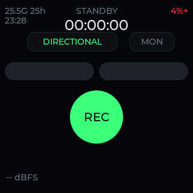

| 自检点 | 说明 |
|---|---|
| `STANDBY` | 待机，未在录音 |
| `00:00:00` | 本次录音计时 |
| `DIRECTIONAL` / `OMNI` | 拾音模式（点一下可切换） |
| `MON` | 耳机监听开关 |
| 中间大圆按钮 | REC / PAUSE / RESUME |
| 底部 `-- dBFS` | 实时电平；待机时显示 `--` |

---

## 2. 录音

### 2.1 开始、暂停、停止

大按钮是**三态循环**：

| 状态 | 按钮 | 点一下 |
|---|---|---|
| 待机 | `REC`（绿） | 开始录音 |
| 录音中 | `PAUSE`（红） | 暂停 |
| 暂停 | `RESUME`（黄） | 继续录到同一文件 |


**停止**有两种方式：

- 按设备正面中间的 **STOP** 键
- **长按**大按钮约 0.5 秒

暂停时计时会停住、电平归零，但文件没关；继续后接着写同一个文件，接缝处做了 5 ms 淡入淡出，
听起来不会有"啪"的一声。

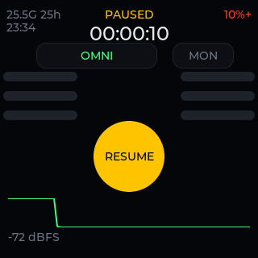

### 2.2 两种拾音模式

| 模式 | 用什么麦克风 | 适合 | 电平条 |
|---|---|---|---|
| `DIRECTIONAL` | 顶部 2 只指向麦（ch6/ch7） | 对着人说话、采访 | 2 条（左右） |
| `OMNI` | 6 只全向麦分左右两组混音 | 会议、环境声、多人 | 6 条（左列 3 + 右列 3） |

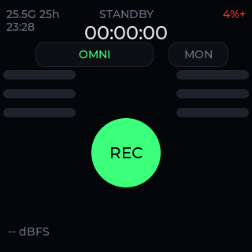

点顶部的模式 chip 切换。**录音中不能切换**（会提示先停止），因为文件头里写了通道含义。

> 阵列实测：6 只全向麦是两排三列、64 × 25 mm（详见 `MIC_ARRAY_GEOMETRY.md`）。
> 目前是直接混音，还没做时延对齐，所以全向模式的高频会比理想状态弱一点。

### 2.3 电平、波形与 dBFS

- 每条电平条是 100 级，1 秒内跟手
- 黄线是**峰值保持**：记录这段里到过的最高电平，方便回看有没有录爆
- 底部绿色曲线是最近 6 秒的电平包络
- 右下 `-24 dBFS` 是当前电平；调音台习惯：0 是满刻度，负数越小越安静

**点一下电平区域**可以复位峰值保持（同时也会把 LED 告警灯熄掉，见 2.5）。

### 2.3.1 耳机监听（MON）

录音页右上角的 `MON` chip 是**实时监听**：插上耳机后点亮它，就能一边录一边听
（延迟约 85–130 ms，用来确认"有没有录进去"足够）。

- 没插耳机时点它会提示 `Plug in headphones to use monitor.`
- 录音停止时监听会自动关闭
- 监听走的是独立的硬件通路，**音量键调不动它**（音量键只影响文件回放）
- 插着耳机时喇叭自动静音，不会啸叫

### 2.4 记录标记（MARK）

录音过程中按设备正面最左边的 **MARK** 键，会在当前文件旁写一条标记（毫秒偏移），
屏幕上弹一个 `MARK 2  00:12:34` 的提示。

- 录音时**不会振动**（马达声会被麦克风录进去），只弹提示
- 文件列表里这一行右侧会出现 `MARK`
- 标记存在 `<文件名>.marks` 里，一行一个毫秒数
- 导出到 DAW：见第 8 节
- 没在录音时按 MARK 不做任何事（只在日志里记一笔）

### 2.5 LED 指示

顶部那颗 RGB 灯平时**不亮**，只在电平出问题时亮，避免长期亮灯干扰录音：

| 情况 | LED |
|---|---|
| 正常录音 / 待机 | 灭 |
| 峰值 ≥ 0.7 满量程（约 −3 dBFS） | 黄色常亮 |
| 峰值 ≥ 0.9 满量程（限制器已经压到顶） | 红色常亮 |
| 点电平区复位 / 停止录音 | 灭 |

黄色意思是"快满了"，可以离远一点；红色意思是"已经在压峰"，这一段会偏闷，最好重录。

### 2.6 自动保护

| 情况 | 行为 |
|---|---|
| 剩余空间 < 0.2 GB | 自动停止录音，状态栏红字 `STORAGE FULL`（**绝不自动删旧录音**） |
| 电量 < 5% 且没插 USB | 自动停止录音，状态栏红字 `LOW BATTERY` |
| 录音中按电源键长按 | 拒绝关机，提示录音中 |
| 录音中 | 允许熄屏，但**禁止休眠** |

### 2.7 文件格式

- 48 kHz 立体声，24-bit（可选 16-bit，体积减半）
- 24-bit 每秒钟约 288 KB，1 小时约 1.04 GB
- **每 1 小时自动换一个文件**（实测第一段正好 3600.0 秒），序号递增
- 断电/崩溃后重新开机，会自动把没闭合的 WAV 头修好（`recovered` 会记在日志里）

---

## 3. 文件页

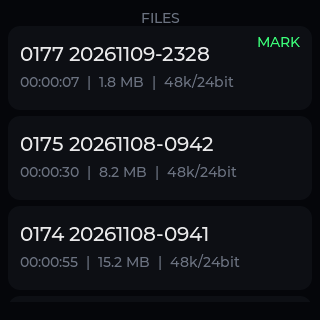

每行显示：文件名（序号 + 开始时间）、**时长**、**大小**、**采样率/位深**，有标记的显示 `MARK`。

- 文件名里的日期可能是 **2019**：设备的 RTC 以前从没被写过，历史文件带着当年的错误时间。
  现在固件会在开机和每 10 分钟把时间写回 RTC，新文件不会再有这个问题（见 6.3）
- **排序按文件名里的序号**，不按时间——序号是单调的，即使时钟错了顺序也不会乱

### 3.1 播放

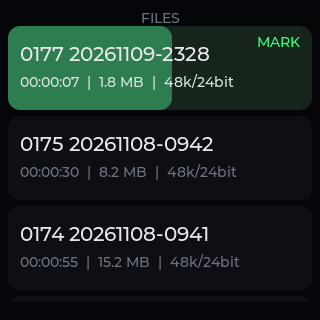

| 操作 | 效果 |
|---|---|
| 点一行 | 开始播放；行底色变绿，背景有进度条按播放位置增长 |
| 再点同一行 | 暂停；第三次点继续 |
| 点别的行 | 换一首 |
| **按住正在播放的行** | 快进（约 4 倍速），松手回到正常速度 |
| 滑到别的页 | 停止播放 |
| 开始录音 | 自动停止播放 |

播放音量用设备侧面的**音量键**调（每档 5%，屏幕显示 `VOL 70%`）；音量会记住，重启后保留。
监听（MON）走的是另一条通路，音量键不影响监听音量。

### 3.2 删除

**长按**一行（不是正在播放的那行）会弹出确认框，选 `DELETE` 删除，`CANCEL` 取消。
删除会连 `.marks` 一起删掉，**不可恢复**。

---

## 4. 设置页

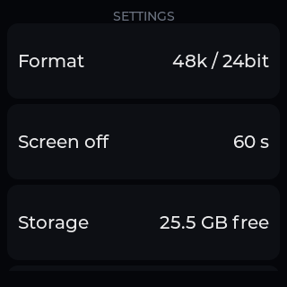

| 项 | 说明 |
|---|---|
| `Format` | `48k / 24bit` 或 `48k / 16bit`。**录音中改会被拒绝**，提示里会写明当前格式 |
| `Screen off` | 自动熄屏时间（30 s / 60 s / 90 s） |
| `Storage` | 剩余空间和大约还能录多久 |
| `WiFi` | 进入 WiFi 子页 |
| `HTTP server` | 网页导出开关，默认关（见第 5 节） |
| `ADB` | USB 调试开关，装机/排障用 |
| `Performance mode` | `ON` 时 CPU 上限放开到 1.3 GHz；`OFF` 与原厂一致用 816 MHz（省电） |
| `Hardware test` | 进入产测程序（触摸、按键、LED、马达、麦克风、回环） |

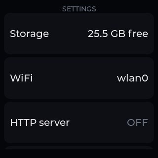

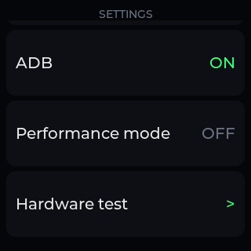

上下滑动设置页看后面的项。设置是即时生效并保存的，重启后保留。

### 4.1 WiFi

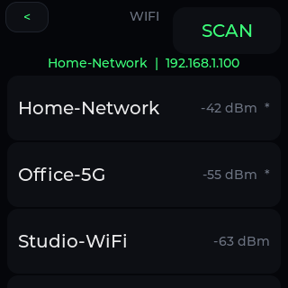

- 顶部一行是当前连接：`SSID | IP`
- `SCAN` 重新扫描（约 3 秒出结果）
- 列表显示信号强度（dBm，越接近 0 越强），带 `*` 表示加密网络
- 点一条加密网络 → 弹出密码键盘

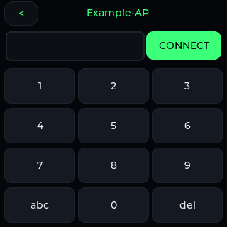

- 左下 `123/abc/ABC` 切换数字与字母层
- 右下 `del` 退格
- 输入满 8 位后 `CONNECT` 才可用
- 连不上会自动回退到之前的网络，**不会删掉已保存的网络**

---

## 5. 用电脑访问（HTTP）

在设置页点开 `HTTP server`，这一行会显示 `192.168.x.x:8080`，然后在同一网络的电脑/手机浏览器打开。

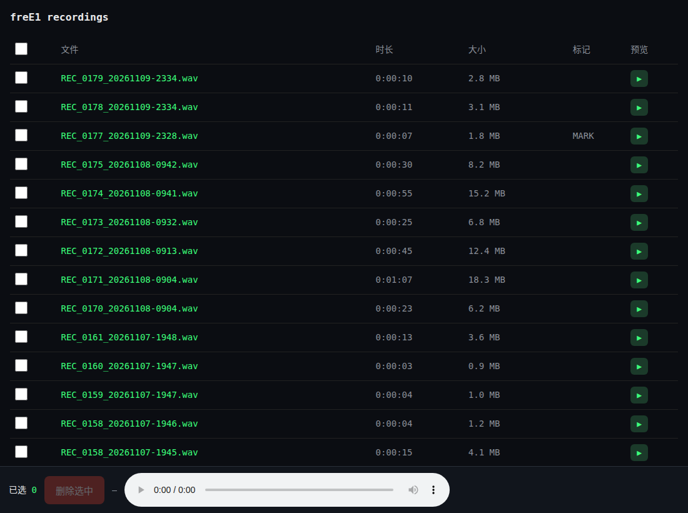

| 功能 | 怎么用 |
|---|---|
| 下载 | 点文件名 |
| 试听 | 点行尾的 ▶，底部播放器直接流式播放，可拖动进度 |
| 多选 | 勾选左侧方框，或用表头全选 |
| 删除 | 勾选后点底部的 `删除选中`，确认后删除（连 `.marks` 一起） |

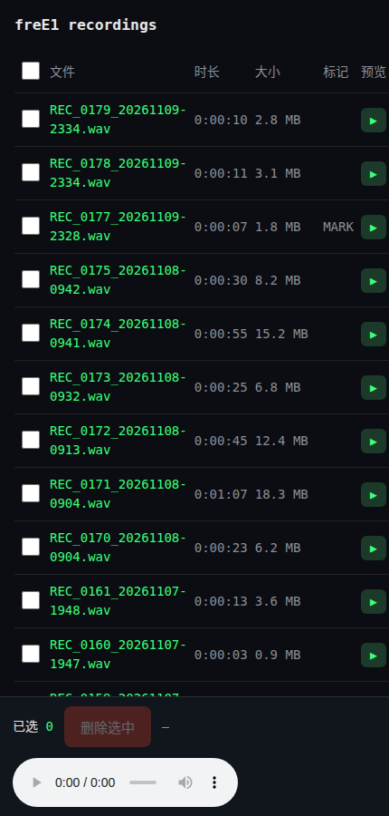

手机上布局会自动收窄，底部固定操作条始终可见。

注意事项：

- **HTTP 没有登录认证**，只在可信网络里开；用完可以再点一下关掉（每次开机默认关闭）
- 删除接口只接受 POST 且要求页面上的令牌，直接访问 `/delete` 会被拒绝（405/403）
- 24-bit WAV 在 Chrome / Edge / Firefox 可以直接试听；**iOS Safari 可能放不出来**，
  这时可以先下载，或把格式切到 `48k / 16bit` 再录

---

## 6. 电源、休眠与时间

### 6.1 电源键

| 操作 | 效果 |
|---|---|
| 短按（亮屏时） | 熄屏 |
| 短按（熄屏时） | 亮屏 |
| 长按 2 秒 | 弹出关机确认（`CANCEL` / `POWER OFF`）；录音中拒绝 |

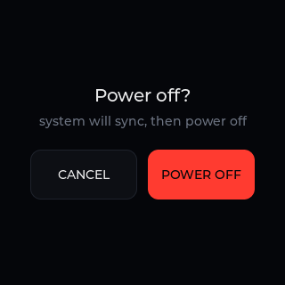

### 6.2 自动熄屏与休眠

- 空闲到 `Screen off` 设定时间 → 熄屏
- 熄屏后再过 3 分钟 → 深度休眠（记录在 `suspend.log`）
- 插着 USB 或正在充电时**不休眠**
- 录音中只熄屏、不休眠
- 唤醒只能按电源键（没有别的事件源）
- 唤醒后的那一次按键会被**吞掉**，不会误触功能键（比如按电源键唤醒后松手不会又熄屏）

### 6.3 时间

- 板上有 RTC（RK808 电源管理芯片内置），**断电后仍会走时**
- 固件开机时和每 10 分钟把系统时间写回 RTC（差超过 60 秒才写）
- 有网络时 NTP 会先校时，再写回 RTC
- 额外还有一份 `last_time` 兜底：每分钟记录一次，开机发现时钟明显偏早就用它顶回去

### 6.4 灭屏时直接开录

灭屏状态下**长按录音键约 0.7 秒**：屏幕亮起并立即开始录音（适合揣兜里快速起录）。
短按只亮屏，不会开始录音。

---

## 7. 数据在设备上的位置

```
/mnt/sdcard/freE1/
  REC_0154_20261107-1852.wav      录音（24-bit 或 16-bit WAV）
  REC_0154_20261107-1852.wav.marks 标记（毫秒偏移，一行一个）
  session.json                    当前/最近一段的状态，用于断电恢复
  boot.log                        运行日志（超过 128 KB 自动轮转一份 .1）
  format / input_mode / volume    设置项
  screen_off_sec / last_time      熄屏时间、最近一次已知时间
  guard.conf                      （可选）自定义保护阈值
```

- 卡是 ext2，无日志；固件每秒 fsync、分段落盘，掉电最多丢最后一秒
- 空间不足时**停止录音**，不会删你的旧文件
- 换卡/清空前记得先把文件拷走（HTTP 页面或读卡器都可以）

---

## 8. 把标记导出到 DAW

标记写在 `<文件名>.marks` 里（纯文本，一行一个毫秒数）。仓库里的脚本可以转成
Audacity 标签、Reaper 工程标记或 CSV，导出的 WAV 也可以写入 CUE 分轨：

```bash
python3 tools/marks-export.py REC_0154_20261107-1852.wav        # 打印
python3 tools/marks-export.py --dir . --all                     # 批量
python3 tools/marks-export.py REC_0154.wav --cue out.wav        # 写 CUE 标记
```

详见 [`MARKS.md`](MARKS.md)。

---

## 9. 常见问题

**文件名里的日期是 2019？**
早期版本从没往 RTC 写过时间，所以每次开机都是 2019。现在的固件开机就会校正 RTC；
旧文件保持原样（序号排序不受影响），要改时间可以重命名。

**为什么没有 44.1 kHz？**
PDM 阵列在 44.1 kHz 下 ch6/ch7 输出恒为 0（驱动问题），所以只保留 48 kHz。

**录出来的声音偏小 / 偏闷？**
阵列没有可调的硬件增益（PDM 卡没有 ALSA 控件，codec 的 ADC 增益实测对阵列无效），
软件 AGC 会把电平拉到 −24 dBFS 左右。声音很小的时候底噪会被一起抬起来，
靠近一点说、或者把音源挪近，效果最好。

**录音中改不了格式/模式？**
这是有意的：文件头已经写好通道和位深，中途改会让文件不一致。停止后再改。

**LED 一直黄/红？**
说明这一段里电平到过 0.7/0.9 满量程。点一下电平区复位即可；要避免就离远一点。

**怎么回到原厂 App？**
`adb shell 'rm -f /userdata/system/SogouE1; killall freE1'`，或者见 [INSTALL.md](INSTALL.md) 的卸载一节。
录音文件都在，不会被删。

**电池能用多久？**
实测（24-bit 录音、48 kHz）：录音约 −180 mA（≈11.7 h），待机亮屏 ≈15 h，熄屏 ≈24 h，
深度休眠 ≈5 天。电池 2100 mAh。

**能当 USB 声卡用吗？**
不能。原厂内核的 USB gadget 只有 adb 和 mtp，没有 UAC。

---

## 10. 规格速查

| 项 | 值 |
|---|---|
| 录音格式 | 48 kHz / 24-bit（可选 16-bit）、立体声、PCM WAV |
| 通道来源 | PDM 8 通道；DIRECTIONAL 用 ch6/7，OMNI 用 ch0–ch5 分列混音 |
| 分段 | 1 小时/段，序号递增 |
| 电平 | AGC 目标 −24 dBFS，峰值上限 0.9 满量程，噪声门限 −55 dBFS |
| 监听 | 进程内 ALSA，延迟约 85–130 ms |
| 回放 | 进程内 ALSA，支持暂停/继续/4× 快进 |
| 存储 | ext2，约 25 GB 可用（24-bit 约 24 小时，16-bit 约 48 小时） |
| 屏幕 | 320×320，LVGL 9.2.2 |
| 整机 | RK3308，2100 mAh，WiFi 2.4 GHz |
