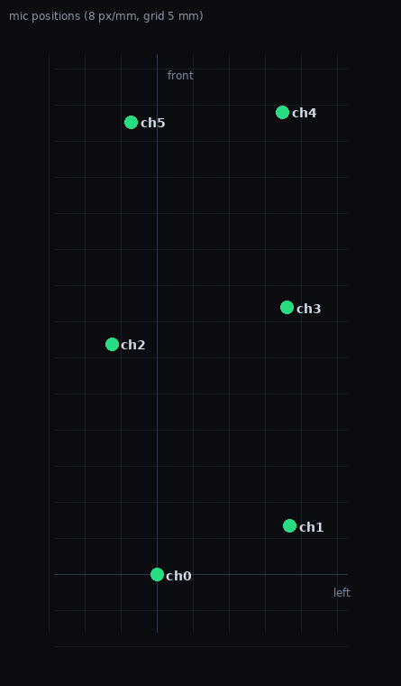

# E1 麦克风阵列几何实测（8 通道原始采集 + TDOA）

> 2026-11-06，设备 ZhiyinOS 1.2.3 / freE1 原始 8 通道采集模式
> 分析脚本：`scripts/geo-tdoa.py`
> 数据：`geo8.wav`（四方位定点，179.8 s）、`geo8dir.wav`（绕设备一圈，42 s），均为 8ch / 48 kHz / S32_LE

## 1. 为什么要另开一条采集通路

录音引擎（`src/engine.c`）内部确实是 `arecord -c 8` 抓 8 路，但**落盘前做下混，只存 2 通道**
（48 kHz / 24 bit / 288 KB/s）。下混把每颗麦的到达时间混在一起，通道间时延信息就没了。

实测印证：用普通录音模式录同一组四方位点播，只能解出两条下混通道的**等效基线 ≈ 17 mm**，
前后方向 ≈ 0——这是"两颗等效点"的特征，换不出 6 颗麦的坐标。

所以几何测量必须走 UI 里的 **RAW 8CH** 模式：`geo_start()` 自己 fork
`arecord -D hw:2,0 -c 8 -r 48000 -f S32_LE`，屏幕显示 `RAW 8CH` + 计时
（该模式下要连按两次才停，避免手碰设备误停）。

## 2. 两种测法，结论差 40%

| 方法 | 做法 | 结果 | 问题 |
|---|---|---|---|
| A. 四方位差分 | 声源放正前/左/右/正后各 15 s，`Δx = c(τ前−τ后)/2`，`Δy = c(τ左−τ右)/2` | 45 × 13 mm | **系统性低估**（见下） |
| B. 绕圈幅度 | 声源绕设备**走一整圈**，τ_ij(t) 是正弦，幅度 = \|Δp\|/c | **64 × 25 mm** | 朝向未定（见 §5） |

方法 A 为什么偏小：两点差分把摆放误差直接算进间距——`Δx` 完全取决于"正前"和"正后"这两次
摆放的角度准不准，摆放偏 20° 就少算 6%，两侧同向偏差还会叠加；它还假设正前/正后严格相对、
距离相等，手工摆放做不到。

方法 B 与摆放角度无关：只要绕完一圈，`τ_ij(t) ≈ (Δp·u(t))/c` 的正弦**幅度**就等于 `|Δp|/c`，
声源具体停在哪些角度、走得匀不匀只影响相位和采样密度。**以 B 为准。**

## 3. 方法 B 的结果（绕圈 42 s，80 次点播）

两两间距（mm，`(p97.5−p2.5)/2 × c`）：

| | ch0 | ch1 | ch2 | ch3 | ch4 | ch5 | ch6 | ch7 |
|---|---|---|---|---|---|---|---|---|
| **ch0** | · | 20.4 | 31.6 | 41.9 | 65.9 | 63.8 | 113.4 | 176.1 |
| **ch1** | 20.4 | · | 37.3 | 31.1 | 58.7 | 59.5 | 128.8 | 229.9 |
| **ch2** | 31.6 | 37.3 | · | 21.3 | 40.1 | 27.9 | 122.4 | 149.7 |
| **ch3** | 41.9 | 31.1 | 21.3 | · | 27.5 | 34.6 | 146.6 | 153.4 |
| **ch4** | 65.9 | 58.7 | 40.1 | 27.5 | · | 22.3 | 138.6 | 124.8 |
| **ch5** | 63.8 | 59.5 | 27.9 | 34.6 | 22.3 | · | 122.7 | 122.9 |
| **ch6** | 113.4 | 128.8 | 122.4 | 146.6 | 138.6 | 122.7 | · | 15.8 |
| **ch7** | 176.1 | 229.9 | 149.7 | 153.4 | 124.8 | 122.9 | 15.8 | · |

6 颗全向麦的 MDS 坐标（ch0 原点，**朝向未定**，mm）：

| 通道 | x | y | \|p\| |
|---|---|---|---|
| ch0 | 0.0 | 0.0 | 0.0 |
| ch1 | +6.7 | +18.4 | 19.6 |
| ch2 | +31.9 | −6.3 | 32.5 |
| ch3 | +37.0 | +18.1 | 41.2 |
| ch4 | +64.1 | +17.5 | 66.4 |
| ch5 | +62.7 | −3.6 | 62.8 |

**张角 64.1 mm × 24.7 mm；两两距离复原残差中位数 1.0 mm。**



## 4. 结构

- **两排 × 三列**：沿长轴 x ≈ 0 / 34 / 63 mm（**列距约 30 mm，基本等距**），
  两排在垂直方向相距 **约 20 mm**。
- 分组与原始文档一致：一排是 **ch5 / ch2 / ch0**，另一排是 **ch4 / ch3 / ch1**。
- 之前文档按机身尺寸推的「纵向 9–10 cm × 横向 3–3.5 cm」**偏大约 1.5 倍**；
  早先按四方位差分得的 45 × 13 mm 又**偏小 30%**，两个都不对，以 64 × 25 mm 为准。

## 5. 还没定下来的事

**朝向**：MDS 只用距离，坐标可以整体旋转和镜像，所以现在只能说"长轴 64 mm、短轴 25 mm"，
不能说"长轴就是前后方向"。要定朝向，再录**两个已知方位**（例如正前 + 正后各 15 s）即可：
一次已知方位的 τ 给出各通道在该方向上的投影，配合已知距离就能解出旋转角。

**ch6 / ch7**：它们与 6 颗全向麦的"表观间距"是 **113–230 mm**，而整机只有 119 × 42 mm，
物理上不可能——说明它们的 TDOA 不是稳定的声学时延（在几个固定值之间跳变）。配合另外两条证据：

1. 四个方位上它们相对 ch0 的 TDOA 恒在 ±25 µs 内（对方向完全不敏感）；
2. 静音时它们的高频（6–14 kHz）噪声比其它通道高 6 dB，彼此相关 0.76、与 ch0 只有 0.26。

**结论：ch6/ch7 不能当独立声学阵元用**（DOA / 波束成形会算错）。要定性得做遮挡或拆机，
手遮测试的分辨率不够（见 §7）。

## 6. 局限

- 绕圈方法假设声源高度不变、绕得足够一整圈；漏掉某个象限会低估对应方向的幅度。
- 左右轴（短轴）只有 25 mm，误差量级 5–8 mm，比例上比长轴差。
- 点播要**停播放再走位**：连着放会让切段失效（本次连着放 30 s，自动切段只切出一段）。

## 7. 做过的无效尝试（省得重踩）

| 尝试 | 结果 |
|---|---|
| 普通录音模式（2 通道下混） | 只能得到"两颗等效点"17 mm 基线，量不了阵列 |
| 手掌逐个盖机身开孔 + 白噪声 | 只能粗糙看出 ch4 与 ch5/ch6/ch7 在同一端；分辨率不足以定位单颗麦 |
| 连续播放边走位 | 无法切段 |
| 四方位定点 | 结果随摆放角度偏 30% |

## 8. 复现

```bash
# 设备端开 RAW 8CH 采集（900 s 上限；连按两次 STOP 才停）
ssh ${E1_HOST:-root@<设备IP>} 'printf "geo 900" > /mnt/sdcard/freE1/.cmd'
# 声源 0.5 m、与设备同高，绕设备走一整圈（约 30 s），期间不停播放
ssh ${E1_HOST:-root@<设备IP>} 'printf "geostop" > /mnt/sdcard/freE1/.cmd'
ssh ${E1_HOST:-root@<设备IP>} 'cat /mnt/sdcard/geo/geo.wav' > lap.wav

# 绕圈幅度法（推荐）
./scripts/geo-tdoa.py lap.wav --amplitude --plot mics.png --save mics.json

# 四方位差分法（会被摆放角度带偏，仅作交叉检查）
./scripts/geo-tdoa.py fixed.wav --segments 84.5,108.5,129.5,152.5 --angles 0,90,270,180
```

其它开关：`--band 1200,10000`（带通）、`--channels 0,1,2,3,4,5`（参与拟合/解算的通道）。
