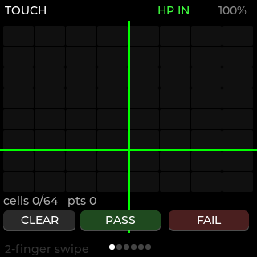

# e1hwtest —— 搜狗 E1 硬件测试程序

跑在 **原厂 ZhiyinOS 1.2.3**（RK3308 / glibc 2.26 / Qt5 只读根分区）上的产测/自检程序，
不刷机、不改根分区，通过原厂预留的启动槽位接管 UI，测完自动回原厂 App。

- LVGL 9.2.2 + 自写 fbdev 后端（本机 `/dev/fb0` 不支持 mmap）
- 自写 MT-B 触摸读取器（st16xx 只报 `ABS_MT_*`，且要拿双指手势）
- 音频全部走设备自带 `arecord` / `aplay`（配方已在真机验证）
- 单文件静态二进制，无运行时依赖（`glibc 2.26` 交叉工具链）



## 1. 快速使用

```bash
# 交叉编译（首次需要先取 LVGL，见 §5；工具链不在本仓库）
export PATH=<你的交叉工具链>/bin:$PATH
make -j8                        # 产物 build/e1hwtest

# 装进设备（设备地址/私钥见仓库根 README 的 e1env 配置）
. ./e1env
SSH="ssh -i $E1_KEY $E1_HOST"
$SSH 'mkdir -p /mnt/sdcard/e1hwtest'
$SSH 'cat > /mnt/sdcard/e1hwtest/e1hwtest && chmod +x /mnt/sdcard/e1hwtest/e1hwtest' < build/e1hwtest

# 运行：freE1 设置页 → Hardware test（推荐，退出后自动回到设置页）
# 或独立运行（自己接管屏幕）：
$SSH 'pkill -x arecord; /mnt/sdcard/e1hwtest/e1hwtest'
```

设备上还有两个兜底手段（**adb 不依赖原厂 App**，已实测）：

```bash
adb shell 'rm /userdata/system/SogouE1; killall e1hwtest'   # 立即回原厂
ssh root@<ip> 'rm /userdata/system/SogouE1; killall e1hwtest'  # WiFi 起来后可用
```

启动链：`init → SogouLunchProbe.sh → /oem/SogouLunch.sh(SSH) → /usr/bin/SogouLunch.sh
→ /userdata/system/SogouE1(本程序) → e1hwtest`。钩子脚本内置崩溃自愈：30 s 内连续
启动 3 次就 `exec /usr/bin/SogouE1`，不会死循环。

## 2. 六个页面与操作

| 页 | 内容 | 操作 | 自动证据 |
|---|---|---|---|
| 1 TOUCH | 8×8 覆盖网格 + 十字线 | 在屏上画一遍；`CLEAR` 归零 | 覆盖格数 / 最大触点数 |
| 2 KEYS · LED | 6 键实时计数/按住时长；顶部 7 色 + 亮度 + 按键红灯 | 逐键按下；点色块/拖滑条/拨开关 | 6 键命中数、电源键时长 |
| 3 LOOPBACK | ch6/ch7 直录 5 s → 峰值归一 → 回放 | 点 `REC`，期间说话/敲击 | 补偿增益、峰值 dBFS、HP/SPK |
| 4 MIC ARRAY | 6 麦按机身位置排布，点大小/颜色/外环表示音量 | 逐一敲击 6 个位置 | 6 路峰值最大值 |
| 5 VIBRATE | SHORT / DOUBLE / LONG | 手持确认 | 触发次数 |
| 6 SUMMARY | 5 项判定 + 证据 + SN/CPU | `FINISH` 落盘并回原厂 | — |

- **翻页**：任意位置**双指**上下滑（单指全部留给测试内容）。页面不滚动、底部没有指示点：
  单指拖动以前会把整页拖着走，底部圆点又压在内容上，两者都已去掉。
- **判定**：每页右下 `PASS` / `FAIL`，结果进入汇总页；未判定的项在报告里是 `SKIP`。
- **耳机**：插入时状态栏显示 `HP IN`，回放自动走耳机（喇叭被硬件静音）；拔出显示 `HP OUT`。
- **麦克风位置**（文档实测）：

```
        左上 ch5        右上 ch4
   左中 ch2                   右中 ch3
        左下 ch0        右下 ch1
```

## 3. 目录与架构

```
hwtest/
├── src/
│   ├── main.c          初始化、主循环（keys/hp/audio/motor + LVGL timer）
│   ├── display_fb.c    /dev/fb0 后端：影子帧 + pwrite 脏区（BGRA = XRGB8888）
│   ├── display_drm.c   可选：双 dumb buffer + page flip（按 25.56 Hz 节拍）
│   ├── input.c         st16xx MT-B 读取 + 双指滑动 + 覆盖统计
│   ├── pages.c         单屏 6 容器、状态栏、导航、各页动态刷新
│   ├── hal_keys.c      event3(KEY_1..5) + event1(KEY_6) 计数/按住时长
│   ├── hal_led.c       /proc/awled_{enable,color,pwm} + /proc/leds_gpio
│   ├── hal_motor.c     /proc/motor_vibr 软件定时脉冲
│   ├── hal_hp.c        event2 EV_SW(SW_HEADPHONE_INSERT) + EVIOCGSW 初值
│   ├── hal_audio.c     arecord/aplay 子进程、8 路电平、5 s 回环
│   └── report.c        JSON + CSV 落盘
└── docs/               每页截图
```

设计上刻意避免了几个坑：

- **不 mmap fb0**：本内核 DRM fbdev 的 `fb_mmap` 返回 `EINVAL`，所以维护一块影子帧，
  `pwrite()` 只写脏区行（全屏 400 KB 约 7.7 ms，实测 52 MB/s）。
- **不用 LVGL 自带 evdev 驱动**：它初始化时读 `ABS_X/ABS_Y`（本机没有），也拿不到双指。
- **不依赖 `%f`**：LVGL 自带 `printf` 不支持浮点（会把 `12.3` 打成 `f`），所有 dB 文案先
  `snprintf` 成字符串再 `lv_label_set_text`。
- **不使用 libdrm / alsa-lib**：不引入交叉编译依赖，音频复用设备上已验证的 `arecord/aplay`。

## 4. 显示同步 / 撕裂优化（可选 DRM 后端）

单缓冲 fbdev 的撕裂风险来自「写内存」与「扫描输出」并行。实测了这台机器的能力：

| 能力 | 结果 |
|---|---|
| `/dev/fb0` mmap | ❌ `EINVAL` |
| `FBIO_WAITFORVSYNC` | ❌ `ENOTTY` |
| DRM dumb buffer / ADDFB / SETCRTC / PAGE_FLIP | ✅ 全部 rc=0（不需要 libdrm，直接 ioctl） |
| flip 完成事件 | ✅ 可用，但约 **11.6 ms（≈85 Hz）** |
| 实际 CRTC 时序 | 345×342 @ 3.0158 MHz = **25.56 Hz**；内核明确 `No driver support for vblank timestamp query` |

即：**flip 事件是"假 vblank"，比真实扫描早**。直接拿它做节拍会把数据写进仍在扫描的 buffer，实测仍会错位。

因此 `display_drm.c` 的做法是：影子帧给 LVGL 画 → 整帧拷进后备 dumb buffer → `PAGE_FLIP`
→ **按面板真实帧率等满 40 ms**（不是等事件）→ 才允许画下一帧；退出/被 kill 时恢复原 CRTC，
初始化失败自动回退 fbdev。

切换后端（写完 `killall e1hwtest`，钩子会自动拉起）：

```bash
echo drm > /mnt/sdcard/e1hwtest/backend   # 双缓冲
echo fb  > /mnt/sdcard/e1hwtest/backend   # 默认：单缓冲 pwrite
echo 40  > /mnt/sdcard/e1hwtest/pace_ms   # DRM 节拍，20..200 ms
echo tear > /mnt/sdcard/e1hwtest/.cmd     # 开关"横扫竖条"撕裂自测
```

**结论**：两种后端在真机上肉眼无差别；移动竖条看到的是**面板拖影 + 背光 PWM**
（背光 255 时只剩拖影），不是撕裂。全屏切换那一帧理论上 fb 会有新旧分界，DRM 不会。
所以默认保留更简单、无 CRTC 接管风险的 fbdev，DRM 作为可选后端。

## 5. 跟手度与 CPU（运行时旋钮）

LVGL 刷新周期、触摸采样周期、UI 定时器三者由同一个旋钮控制：

```bash
echo 33 > /mnt/sdcard/e1hwtest/refresh_ms   # 15..100，默认 33
killall e1hwtest
```

早期每个 tick 都无条件 `lv_label_set_text` / 改样式，LVGL 会整片重绘，静止页面也要吃掉
十几% CPU；麦克风页因为 dB 数字抖动，20 ms 下高达 49.6%。改成「值变了才刷」
（`pages.c` 里的 last_* 缓存）+ 文本按 3 dB / 半径按 2 px 量化后：

| 场景（单核 100%） | 优化前 | 优化后 |
|---|---|---|
| TOUCH 静止，33 ms | 15.1% | **0.8%** |
| TOUCH 静止，20 ms | 21.7% | 1.0% |
| MIC 阵列（录音 + 电平），33 ms | — | 8.1% |
| MIC 阵列（录音 + 电平），20 ms | 49.6% | 8.6% |

默认取 **33 ms**（约 30 fps）：面板本身只有 25.56 Hz，再快不会让交互更顺，只会多写帧、
扩大全屏切换时的撕裂窗口。录音笔这类低频交互没有更高刷新率的需求。
需要试更跟手的画线可以临时 `echo 20 > .../refresh_ms`，代价约 +0.2 个百分点。
麦克风页剩下的 ~8% 主要是 8 通道 RMS 计算，与刷新周期基本无关。

## 6. CPU 频率（RK3308）

原厂 App 启动时把 `scaling_max_freq` 压到 **816 MHz**，而硬件 OPP 表到 **1296 MHz**：

| 项 | 值 |
|---|---|
| 可用频点 | 408 / 600 / 816 / 1008 / 1200 / **1296** MHz |
| 原厂策略 | governor=interactive，max=816 MHz |
| 限制来源 | `/usr/bin/SogouE1` 自己写 `scaling_max_freq`（不是热保护；冷却设备绑定在 90 °C 才动作） |
| 实测收益 | 同一负载 1.042 s → 0.654 s（**1.59×**，等于频率比） |
| 发热 | 10 s 满载：46.8 → 49.1 °C；trip 55/90/115 °C，降到 90 °C 才触发降频 |
| DDR | 无 devfreq 节点，不可调 |

本程序默认把上限提到 **1296 MHz**（仍用 interactive 按需升降，不常驻满载）：

```bash
ls /mnt/sdcard/e1hwtest/cpu        # 不存在或内容为 max -> 1296 MHz
echo stock > /mnt/sdcard/e1hwtest/cpu   # 回到原厂 816 MHz，重启程序生效
```

手动（对原厂 App 也有效，运行期不会自动改回，但**重启后原厂会重新设回 816**）：

```bash
echo 1296000 > /sys/devices/system/cpu/cpufreq/policy0/scaling_max_freq
```

注意：这是厂商的功耗/散热策略上限，长时间满载会更耗电、更热；测试工具场景（通常插 USB）影响有限。

## 7. 决定设计的硬件事实（全部真机实测）

| 事实 | 证据 / 影响 |
|---|---|
| `/dev/fb0` 不能 mmap，但可 `read/write` | `fbinfo` 探针：`mmap EINVAL`；像素格式 `R@16 G@8 B@0`（内存 BGRA） |
| 触摸只有 MT-B，2 个 slot | `evtest` 能力表：只有 `ABS_MT_SLOT/POSITION/TRACKING_ID`，无 `ABS_X/Y` |
| 插耳机时内核只发 `EV_SW`，**不做路由** | 插拔时 `DAC HPOUT` 始终 `-inf`；用户态设 `HPOUT=20` 才出声 |
| 播放流关闭后 `HPOUT` 被驱动复位为 `-inf` | 必须在**每次播放前**重新 arm，不能开机设一次 |
| 插入耳机时喇叭由硬件自动静音 | 无需软件切 `LINEOUT` |
| PDM 开流有 ~0.2 s 满量程瞬态 | 电平表与录音都要丢弃前 400 ms，否则首屏满格、录音 peak=0 dBFS |
| PDM 必须 32 kHz / S32_LE / period 2400 | 其他组合只有底噪（前次逆向结论已复现） |
| 电源键长按 ~6 s 是 PMIC 硬关机 | UI 只在按住 >2 s 时红字警告，不做长按功能测试 |
| `awled_enable` 在原厂 App 死后可写 | 替换后实测 `enable=1/color=2/pwm=200` 回读一致 |
| adb / dropbear 不依赖应用 | 假 App 接管 + 重启后 `adbd`、`dropbear` 均独立存活 |

## 8. 构建

需要 `cross/` 里那套 Bootlin aarch64 工具链（gcc 6.4 / glibc 2.26）：

```bash
make deps          # 从 gitee 镜像取 LVGL v9.2.2（约 200 MB）
export PATH=<你的交叉工具链>/bin:$PATH
make -j8
```

产物 `build/e1hwtest`：静态链接、无 GLIBC 符号版本需求（用交叉工具链自带的 `readelf -V` 可复核）。

## 9. 报告

`FINISH` 后写到：

- `/mnt/sdcard/e1hwtest/results/<CPU Serial>-<YYYYmmdd-HHMMSS>.json`
- `/mnt/sdcard/e1hwtest/results.csv`（追加一行，便于产线表格）

```json
{
  "sn": "<16 位整机 SN>",
  "cpu_serial": "<16 位 CPU Serial>",
  "mac": "<设备 MAC>",
  "firmware": "1.2.3",
  "time": "2026-11-04 06:46:32",
  "items": [
    {"id": 0, "result": "PASS", "evidence": "cells 40/64, max pts 2"},
    {"id": 1, "result": "PASS", "evidence": "6/6 keys pressed, pwr hold 320ms"},
    {"id": 2, "result": "PASS", "evidence": "gain +26 dB, peak -31 dBFS, HP"},
    {"id": 3, "result": "PASS", "evidence": "omni peak max -18 dBFS"},
    {"id": 4, "result": "PASS", "evidence": "4 pulses fired"}
  ]
}
```

## 10. 调试钩子（仅诊断用）

`/mnt/sdcard/e1hwtest/` 下的文件会被轮询一次后删除：

| 文件 | 内容 | 作用 |
|---|---|---|
| `.page` | `0`..`5` | 直接跳页（自动化截图用） |
| `.cmd` | `rec` / `play` / `vib0..2` / `led <c> <p>` / `kbled 0\|1` / `pass N` / `fail N` / `shot` / `tear` / `finish` | 无手指驱动 HAL 自检 |

## 11. 已知限制

- 默认 fbdev 单缓冲：全屏切换那一帧理论上有撕裂窗口（实测不可见）；需要严格无撕裂时
  切到 DRM 后端（`echo drm > /mnt/sdcard/e1hwtest/backend`）。
- 移动细竖条时的条纹/闪烁来自 LCD 拖影与背光 PWM，不属于撕裂。
- 触发式按键（电源）短按即计一次；长按 6 s 会真的关机，属硬件行为。
- 回放音量按峰值归一到 -6 dBFS、最多 +30 dB；极安静环境下录音仍然偏轻，测试时需出声。
- 结果时间依赖设备 RTC（联网后 NTP 会校正）。
- 本程序只验证**硬件通路**，不包含原厂的 MVDR/NNSE 定向拾音算法。
